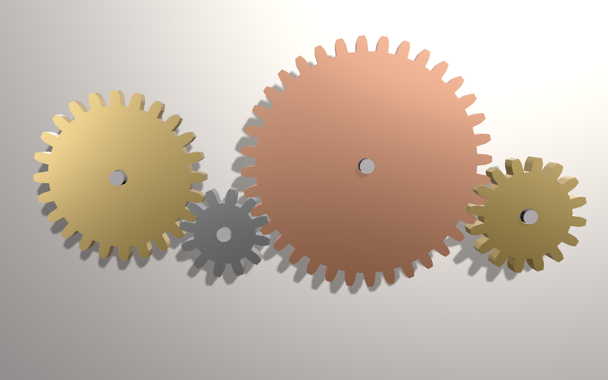

# SceneSprockets

A 3D scene graph for [MetalSprockets](https://github.com/schwa/MetalSprockets), with an API modeled on SceneKit. You build a tree of nodes with meshes, lights and cameras. Then you render it with Blinn-Phong, PBR or your own Metal shaders.



*The Gears demo. The source is in `Examples/SceneSprocketsDemo/Packages/SceneSprocketsDemoSupport`.*

## Features

- A [node hierarchy](https://schwa.github.io/SceneSprockets/documentation/scenesprockets/scenegraph/node/) with transforms, visibility, opacity, category masks and [built-in shapes](https://schwa.github.io/SceneSprockets/documentation/scenesprockets/scenegraph/shape/)
- [Blinn-Phong](https://schwa.github.io/SceneSprockets/documentation/scenesprocketsblinnphong/), [PBR](https://schwa.github.io/SceneSprockets/documentation/scenesprocketspbr/) with most glTF material extensions, and [custom shaders](https://schwa.github.io/SceneSprockets/documentation/scenesprocketsshadermaterial/)
- [Shadows](https://schwa.github.io/SceneSprockets/documentation/scenesprockets/scenegraphshadows/) for every light type, fog, ambient occlusion and post-processing
- [Actions](https://schwa.github.io/SceneSprockets/documentation/scenesprockets/scenegraph/action/), [implicit animation](https://schwa.github.io/SceneSprockets/documentation/scenesprockets/scenegraph/transaction/), [keyframed clips](https://schwa.github.io/SceneSprockets/documentation/scenesprockets/scenegraph/animationclip/) with blending, morph targets and skinning
- [Constraints](https://schwa.github.io/SceneSprockets/documentation/scenesprockets/scenegraph/constraint/), including inverse kinematics
- Rigid-body [physics](https://schwa.github.io/SceneSprockets/documentation/scenesprocketsphysics/) on Jolt, [GPU particles](https://schwa.github.io/SceneSprockets/documentation/scenesprockets/sceneparticlesystem/) and positional [audio](https://schwa.github.io/SceneSprockets/documentation/scenesprocketsaudio/)
- Loading from [glTF](https://schwa.github.io/SceneSprockets/documentation/scenesprocketspbr/gltfscenegraph/) and [Model I/O](https://schwa.github.io/SceneSprockets/documentation/scenesprocketspbr/modelioscenegraph/) (OBJ, PLY, STL, ABC, USD), and saving with [`Archive`](https://schwa.github.io/SceneSprockets/documentation/scenesprockets/scenearchive/)
- [`SceneView`](https://schwa.github.io/SceneSprockets/documentation/scenesprockets/sceneview/) for SwiftUI, with camera control, hit testing and [transform gizmos](https://schwa.github.io/SceneSprockets/documentation/scenesprocketsgizmos/)
- Node data stored in a [SwiftECS](https://github.com/schwa/SwiftECS) world that you can [query with your own systems](https://schwa.github.io/SceneSprockets/documentation/scenesprockets/workingwiththeworld/)

See [CHANGELOG.md](CHANGELOG.md) for the full list.

## Requirements

SceneSprockets needs Swift 6.2 or later, and iOS, macOS or visionOS 26 or later.

## Installation

```swift
.package(url: "https://github.com/schwa/SceneSprockets", from: "0.1.0")
```

Each material family is its own product, so an app links only what it uses:

| Product | Contents |
|---|---|
| `SceneSprockets` | The scene graph, renderer, shadows, fog, post-processing, particles and `SceneView` |
| `SceneSprocketsBlinnPhong` | Blinn-Phong materials |
| `SceneSprocketsPBR` | PBR materials, glTF and Model I/O loading |
| `SceneSprocketsShaderMaterial` | Materials with your own vertex and fragment shaders |
| `SceneSprocketsPhysics` | Rigid-body physics on Jolt |
| `SceneSprocketsAudio` | Positional audio on nodes |
| `SceneSprocketsGizmos` | Transform gizmos and selection outlines |

Optional generators, such as point clouds, are in the separate [SceneSprocketsAddOns](https://github.com/schwa/SceneSprocketsAddOns) package.

## Usage

```swift
import SceneSprockets
import SceneSprocketsBlinnPhong
import SwiftUI

// Build a tree of nodes: a light and a box.
let root = SceneGraph.Node(label: "Root")
root.addChild(.light(.point(intensity: 20, range: 100), transform: .init(translation: [2, 3, 2])))
let material = BlinnPhongSceneMaterial(color: [0.8, 0.5, 0.2], shininess: 16)
let box = root.addChild(SceneGraph.Node(shape: .box(), material: material))

// Spin the box forever.
box.run(.repeatForever(.rotate(by: 2 * .pi, around: [0, 1, 0], duration: 4)))

// Show it in SwiftUI. With no camera node, SceneView frames the scene with a default camera.
struct ContentView: View {
    let sceneGraph = SceneGraph(root: root)

    var body: some View {
        SceneView(sceneGraph, renderers: [BlinnPhongMaterialRenderer()])
            .sceneCameraControl()
    }
}
```

The documentation has articles on [getting started](https://schwa.github.io/SceneSprockets/documentation/scenesprockets/gettingstarted/), [rendering](https://schwa.github.io/SceneSprockets/documentation/scenesprockets/rendering/), [animation](https://schwa.github.io/SceneSprockets/documentation/scenesprockets/animation/), [change tracking and queries](https://schwa.github.io/SceneSprockets/documentation/scenesprockets/changetracking/), and [working with the SwiftECS world](https://schwa.github.io/SceneSprockets/documentation/scenesprockets/workingwiththeworld/).

## Demos

`Examples/SceneSprocketsDemo/Packages/SceneSprocketsDemoSupport` has the demos: a keynote-style tour of the features, Gears, Dice, Shadows, a SceneKit feature comparison, and Tree Appreciator, a small game.

To run the demos in Xcode, open `Examples/SceneSprocketsDemo/SceneSprocketsDemo.xcodeproj`. To run them from the command line, use these commands:

```sh
cd Examples/SceneSprocketsDemo/Packages/SceneSprocketsDemoSupport
xcb run scenesprockets-demos                                   # opens the demo picker
scenesprockets-demos --render gears gears.png --size 1280x800  # renders a demo to a PNG
```

The demos use third-party models and textures under CC0 and CC BY 4.0. See [CREDITS.md](CREDITS.md).

## Documentation

[SceneSprockets documentation](https://schwa.github.io/SceneSprockets/documentation/)

## License

SceneSprockets uses the MIT license. See [LICENSE](LICENSE).
